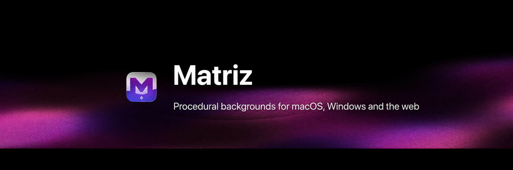
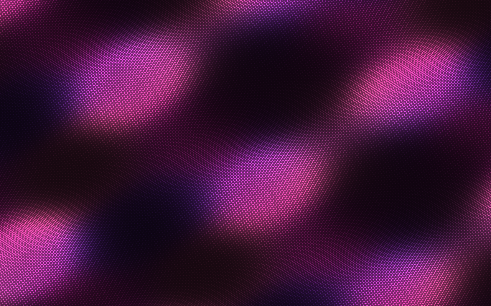
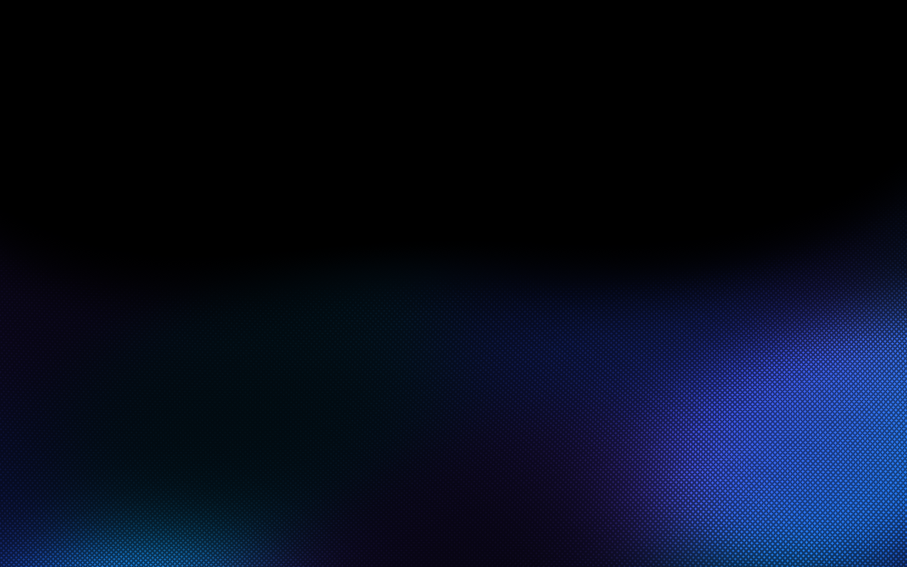
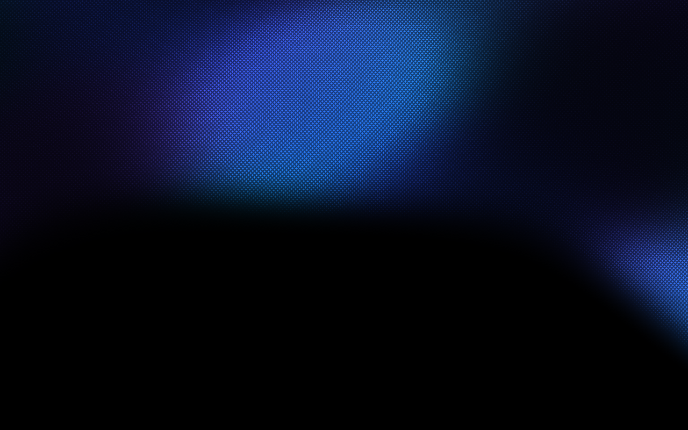
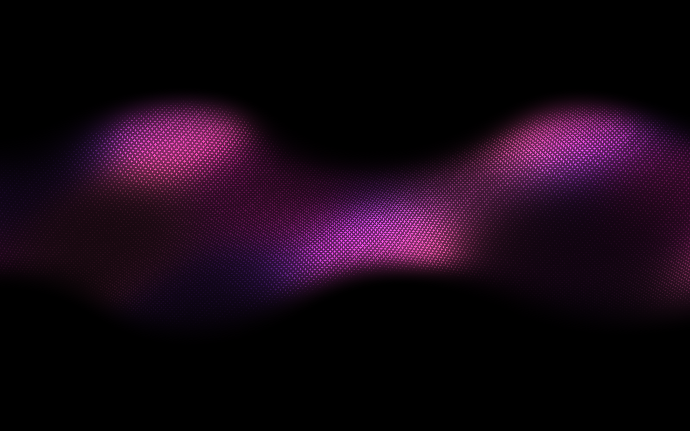
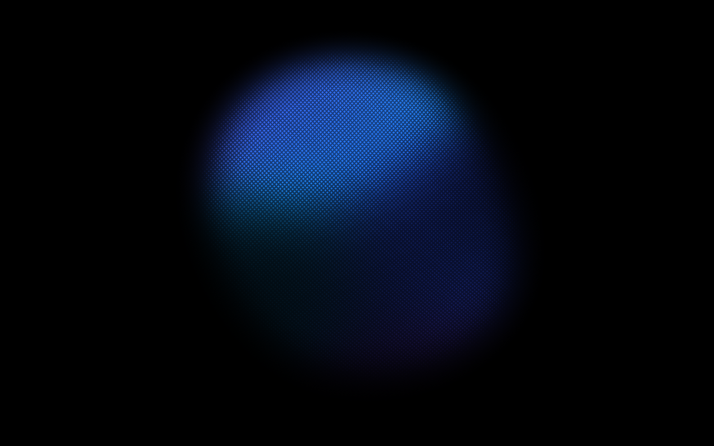
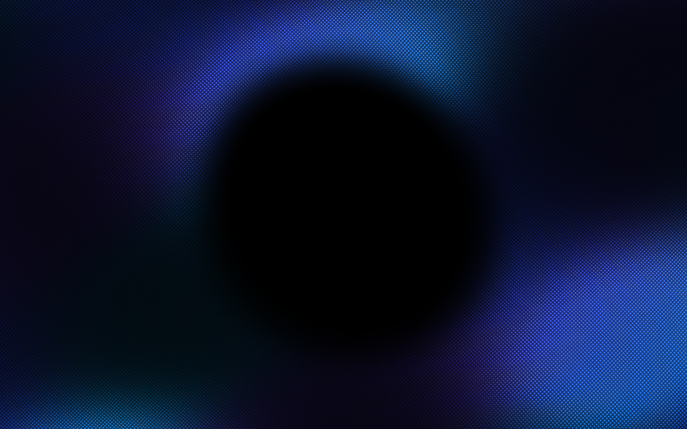
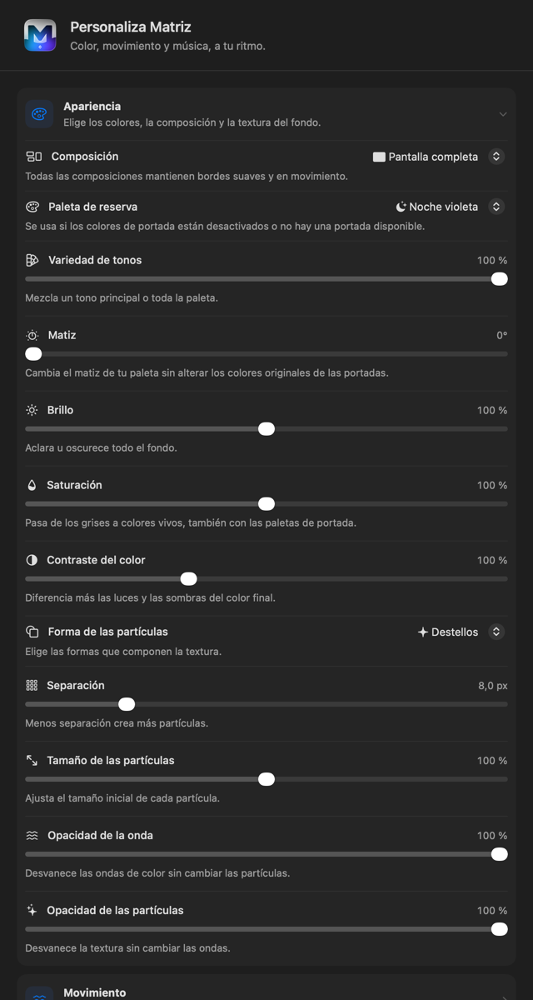
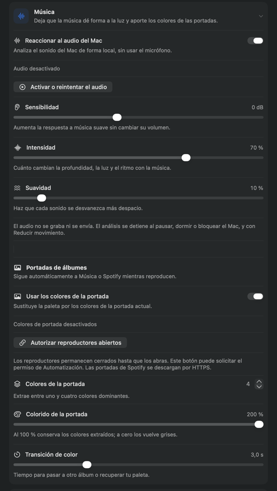

<div align="center">
  
</div>

<h1 align="center">Matriz</h1>

<p align="center">
  <strong>A procedural background for macOS, Windows and the web:</strong> waves of light, geometric sparkles and organic color.
</p>

<p align="center">
  
  
  
  
</p>

<p align="center">
  <a href="https://github.com/jesusjodar/Matriz/releases"><strong>⬇️ Download the latest release</strong></a>
</p>

---

Matriz draws behind your desktop icons on every display. An organic field of light, color and sparkles moves slowly: depth animates each particle's size while the flow moves its center without deforming its shape. It does not use the mouse, sensors or clicks. If enabled, Matriz analyzes your Mac's audio output and replaces its palette with colors from the currently playing album artwork.

## Windows and web component

Matriz also provides a [Windows app with native WinUI 3 settings](windows/README.md) for x64 and ARM64 and a [ready-to-integrate web component](packages/web/README.md). Download the [2.3.0 packages](https://github.com/jesusjodar/Matriz/releases/tag/v2.3.0): [Windows x64](https://github.com/jesusjodar/Matriz/releases/download/v2.3.0/Matriz-Windows-x64.zip), [Windows ARM64](https://github.com/jesusjodar/Matriz/releases/download/v2.3.0/Matriz-Windows-ARM64.zip), [web without build tools](https://github.com/jesusjodar/Matriz/releases/download/v2.3.0/Matriz-Web-2.3.0.zip) or the [local npm package](https://github.com/jesusjodar/Matriz/releases/download/v2.3.0/matriz-background-2.3.0.tgz). Further changes are also checked by the [multiplatform workflow](https://github.com/jesusjodar/Matriz/actions/workflows/multiplatform.yml).

The web component is visual only: **no music, AI or visible settings**. Configure values directly in JavaScript or through the `settings` attribute. It includes a [complete example](packages/web/example.html), TypeScript types, ESM modules and a classic script.

| Feature | macOS | Windows | Web |
|---|---|---|---|
| Shader, palettes and visual settings | Metal | WebGL2 | WebGL2 |
| Native panel | SwiftUI / Liquid Glass | WinUI 3 | Configuration through code |
| System audio | Core Audio Taps | WASAPI loopback | — |
| Album artwork palette | Music / Spotify | Windows media sessions | — |
| Agent states | Local hooks | Local hooks | — |
| Desktop | All displays | Explorer virtual desktop | HTML container background |
| Screensaver | `.saver` and extension | — | — |
| Wallpaper / lock screen extension | macOS 26+, private API | — | — |

Future changes maintain all three clients through a shared shader, a settings contract in `shared/` and builds for all three platforms. Platform-specific integrations stay outside the web API. Automated Windows builds do not replace physical checks of Explorer, audio and media players.

The rest of this guide describes the **macOS** app; see the linked guides for Windows installation and web integration.

## Contents

- [What is Matriz?](#what-is-matriz)
- [Style gallery](#style-gallery)
- [Settings panel](#settings-panel)
- [Installation](#installation)
- [Getting started](#getting-started)
- [Music and album artwork](#music-and-album-artwork)
- [Screensaver and lock screen](#screensaver-and-lock-screen)
- [Performance](#performance)
- [Privacy](#privacy)
- [Frequently asked questions](#frequently-asked-questions)
- [Uninstalling](#uninstalling)
- [Development](#development)
- [Author](#author)

## What is Matriz?

- **Animated desktop background.** Sits behind icons and Finder on every display without interfering with your work.
- **Six compositions.** From full screen to soft-edged orbs that can fill the entire monitor.
- **Nine palettes and custom color.** Four pigments follow the relief, with organic noise and adjustable smoothing; you can also choose your own colors.
- **Sparkles with character.** Stars, circles or squares; depth-based sizing, adjustable concavity and displacement up to 400%.
- **Music in color.** With your permission, Matriz analyzes system audio and uses Music or Spotify album colors, with interruptible transitions.
- **Screensaver included.** The same visual style when your Mac is idle, with shared settings.
- **20 complete languages**, including Arabic and Hebrew with right-to-left layouts.
- **No accounts, telemetry or background services.** Everything happens on your Mac.

## Style gallery

Choose from six styles in **Appearance → Composition**. Their edges follow the same motion field, gently fading and shrinking nearby sparkles without straight cuts.

| | |
|:---:|:---:|
|  <br> **Full screen** — waves and sparkles fill the background. |  <br> **Lower wave** — the default style: a lower center and raised sides with an organic edge. |
|  <br> **Upper wave** — the inverse of the lower wave. |  <br> **Center wave** — a horizontal band with changing edges. |
|  <br> **Orb** — a rounded shape with a soft outline, scalable from 20% to 600%, with an adjustable center. |  <br> **Inverse orb** — a central opening with the same features and position and size controls. |

Adjust the **wave position** in the lower, upper and center styles (up or down); for orbs, adjust the **center** on both axes.

Under **Sparkles → Particle shape**, choose stars, circles or squares. Concavity controls appear only for stars, and their values are retained when changing shapes.

## Settings panel

Opening Matriz from Finder shows its panel with a black background, native Liquid Glass navigation and six tabs. Changes apply immediately, including to the screensaver, which shares the same settings. The screenshots below show the Spanish localization.

| Appearance and color | Music and album artwork |
|:---:|:---:|
|  |  |

- **Appearance** — composition, wave and orb position, palette, variety, color noise smoothing, hue, brightness, saturation and contrast.
- **Particles** — shape, density, size, opacity, depth, shadow light and gradual size and concavity changes: small sparkles have deeper curves than large ones.
- **Motion** — pace, volume size and displacement, more restrained in shadows with gentle drift along the crests.
- **Music** — audio response, sensitivity, intensity, smoothing and artwork colors. Artwork saturation starts at 100% for new settings.
- **AI agents** — state-based palettes and connectors for Codex, Claude Code, OpenCode, Hermes, LM Studio and other agents.
- **General** — performance, screensaver, locking and about.

Highlights are compressed through a smooth curve before reaching the SDR limit. Color keeps its proportions, and stable dithering reduces quantization banding.

Matriz also respects macOS **Reduce Motion**, which leaves a still image, and **Low Power Mode**, which forces the Energy Saving profile. **Reset…** affects only Matriz.

## Installation

### Requirements

- macOS 14 Sonoma or later. Audio response requires macOS 14.2 or later; the Wallpaper extension requires macOS 26 or later.
- An Apple Silicon Mac. The release is built for arm64; on Intel Macs, [build from source](#development).
- No account or permanent internet connection required.

### Download and verify

Download the archive from the [releases page](https://github.com/jesusjodar/Matriz/releases) and check its integrity:

```sh
curl --fail --location -o Matriz-macOS-arm64-2.3.0.zip https://github.com/jesusjodar/Matriz/releases/download/v2.3.0/Matriz-macOS-arm64-2.3.0.zip

curl --fail --location -o SHA256SUMS https://github.com/jesusjodar/Matriz/releases/download/v2.3.0/SHA256SUMS
shasum -a 256 -c SHA256SUMS --ignore-missing
# Expected: Matriz-macOS-arm64-2.3.0.zip: OK
# SHA-256:
# e3eed67d35919266bf96874aefe633913e072b33ca4a32c99bba7cbd4067aa8a
```

### Remove macOS quarantine

Matriz is locally signed and not notarized by Apple, so macOS marks the download as quarantined. Remove quarantine before opening it (otherwise you may see “cannot be opened” or “is damaged”):

```sh
unzip -q Matriz-macOS-arm64-2.3.0.zip
xattr -dr com.apple.quarantine Matriz.app Matriz.saver
```

### Install and open

The app goes in `~/Applications` and the screensaver in `~/Library/Screen Savers`:

```sh
mkdir -p ~/Applications "$HOME/Library/Screen Savers"
cp -R Matriz.app ~/Applications/
cp -R Matriz.saver "$HOME/Library/Screen Savers/"
open ~/Applications/Matriz.app
```

### Update from an earlier version

See the [complete 2.3.0 commands](docs/releases/v2.3.0.md#install-or-update-and-remove-quarantine-on-macos): they back up the previous bundles before replacing them. Existing preferences are preserved.

## Getting started

1. Open Matriz: a sparkle icon appears in the menu bar and the background starts animating behind desktop icons.
2. Choose **Settings…** from the menu bar (or reopen Matriz from Finder) to select the composition, palette and motion.
3. On macOS 26 or later, select **Matriz** in **System Settings → Wallpaper** to use the extension. Choose it under **Screen Saver…** for idle use too; the standalone module remains available among custom screensavers.

The menu bar lets you **pause animation**, open **settings**, open **screensaver settings**, read about **locking**, or **quit and remove the background**. Quitting removes the desktop layer. If you selected the extension under Wallpaper, macOS retains that selection.

## Music and album artwork

Matriz can react to your Mac's audio output and borrow colors from the current album artwork:

1. Enable **React to Mac audio** under Music and press **Enable or retry audio**.
2. Enable **Use album artwork colors** under Music → Album artwork.
3. With the Music or Spotify desktop app open, press **Authorize open players**.

How it works:

- **No microphone.** Core Audio Taps analyzes the default system output: bass, mids, treble and energy. Audio is never recorded, saved or sent anywhere.
- **Players do not open automatically.** Every two seconds, already open and authorized players are checked; if both are playing, the selected one is retained to avoid constant switching.
- **Local artwork processing.** Music artwork is read through public Apple Events; only Spotify's artwork image is downloaded over HTTPS. Colors are extracted on your Mac (up to four representative tones, including white, black, gray and pastels, in OKLab) and never saved.
- **Frequency response.** Bass expands wave height, center-band width and orb size. Treble changes orb contours and particle details; each band has its own level reference.
- **Smooth transitions.** On song or player changes, the palette blends from the visible color without jumps. Missing artwork or stopped playback restores your chosen palette.
- **Stops when unnecessary.** Capture and polling are released when disabling, pausing, sleeping, locking or quitting. Reduce Motion suspends both features.

Note: Music does not guarantee artwork for streaming broadcasts or radio, and remote players (Spotify Connect, browsers) may provide sound without artwork.

## Screensaver and lock screen

The app includes a **Wallpaper extension** that offers Matriz in **System Settings → Wallpaper** for the desktop, lock screen and system screensaver. It uses the original Metal shader and receives a copy of your visual settings. The system wallpaper selection persists after quitting Matriz.

The standalone `Matriz.saver` module remains available and shares appearance preferences. Music and artwork are processed only in the desktop app.

The extension uses private `WallpaperExtensionKit` interfaces: macOS updates may require adaptations. It does not change passwords or FileVault. See the [Wallpaper and locking guide](docs/wallpaper-extension.md) and the [agent guide and its official sources](integrations/README.md).

## Performance

- One rendering pass, without noise textures or external assets, using an SDR pipeline.
- One Metal device, queue and pipeline shared across all displays.
- Palettes and static parameters prepared on the CPU when settings change; masks are skipped when opacity is zero.
- **Energy Saving:** 30 FPS and 1× scale. **Balanced:** 60 FPS and 1.5×. **Maximum:** 60 FPS and 2×. Scale never exceeds your display's scale, and Low Power Mode forces Energy Saving.
- Bounded clock and phases prevent jumps when changing speed, pausing or recreating displays.

These figures describe the workload profile, not a frame-rate guarantee for every GPU.

## Privacy

- Audio is **never recorded or transmitted**; only its energy and frequency distribution are analyzed in memory.
- No artwork, titles or audio are saved.
- No accounts, sign-in, telemetry or analytics.
- Potential permissions (system audio recording and player automation) are requested only when you press the corresponding button, and can be revoked in **Privacy & Security**.

## Frequently asked questions

**Does Matriz record the microphone or Mac audio?**
No. It analyzes system audio output through macOS capture APIs in memory without retaining anything. It never turns on the microphone.

**Why does my usual wallpaper return when I quit?**
The app draws a layer that disappears on exit. You can also choose its extension as the system wallpaper; macOS keeps that selection until you choose another wallpaper.

**Does it work on an Intel Mac?**
The release is built for Apple Silicon. On Intel, build the project from source; it only needs Xcode tools.

**Can I use just the screensaver?**
Yes. Install `Matriz.saver` and select it in System Settings → Screen Saver. Appearance and motion settings are shared with the app.

**Where are my settings saved?**
In preferences for `com.matriz.screensaver`. Reset affects only Matriz; your wallpaper and macOS settings remain intact.

**Is there a web version?**
Yes. Use the [standalone web component](packages/web/README.md) in WebGL2 browsers, or `npm run dev` for the development preview. The native app provides the full settings panel, persistence, audio and screensaver experience.

**Why does my app say it cannot be opened?**
Gatekeeper quarantines non-notarized apps: run `xattr -dr com.apple.quarantine Matriz.app Matriz.saver` and open it again.

## Uninstalling

1. If you selected the extension, choose another wallpaper in System Settings.
2. Quit Matriz and remove the two installed bundles:

```sh
rm -rf ~/Applications/Matriz.app "$HOME/Library/Screen Savers/Matriz.saver"
```

macOS may retain granted permissions; revoke them in **System Settings → Privacy & Security** if desired.

## Development

The project combines a web preview (Vite, TypeScript and WebGL2) with the native app (AppKit, SwiftUI and Metal). The GLSL shader is the single visual source: Metal is generated from it during builds so the web and app share equations.

Requires Node with npm and Xcode tools. Full builds and Wallpaper extension checks require a macOS 26 SDK or later and a compatible system.

```sh
npm install          # development dependencies
npm run dev          # web preview with the live shader
npm run build        # build the web into dist/
npm test             # animation and localization tests
npm run macos:build  # build Matriz.app and Matriz.saver
npm run macos:check  # full Metal validation + style screenshots
npm run macos:install # install the builds in your session
```

`macos:check` also validates the Wallpaper catalog, remote context and IOSurface capture. It checks actual rendering, determinism, settings, six compositions, three geometries, 400% displacement, interprocess communication, DSP and color extraction. It saves `Matriz-style-N.png` screenshots for each style and the `Matriz-styles-preview.png` contact sheet in `~/Library/Application Support/Matriz/Build/`.

Structure:

- `src/` — GLSL shader (`sparkles.frag`), web page and styles.
- `macos/` — app, screensaver, Metal renderer, audio, artwork and settings panel.
- `scripts/` — native builds and localization.
- `tests/` — animation and 20-language tests.
- `docs/` — README images and development notes.
- `design/` — icon design sources.

The 20 localizations originate in `macos/Localizable.xcstrings` and are packaged as native `.lproj` resources. The icon is in `macos/Assets/Matriz.icon` and compiled with `actool`.

## Author

**Jesús Jódar Piernas** — 3D artist, developer and technology enthusiast.

[GitHub](https://github.com/jesusjodar) · [Portfolio](https://jesusjodar.github.io) · [LinkedIn](https://linkedin.com/in/jesujopi/) · [X](https://x.com/jesujopi3D) · [Email](mailto:jesusjodarpiernas@gmail.com)

<p align="center">Made with ❤️ in Spain 🇪🇸</p>
