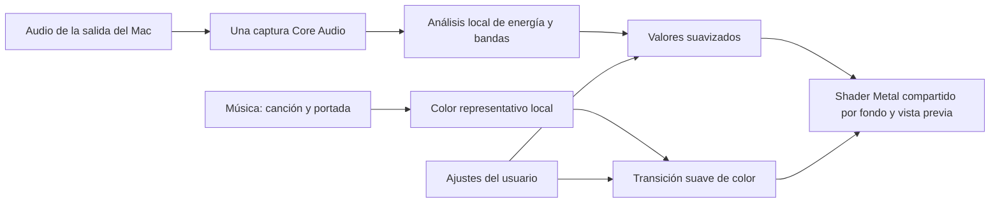

> Diseño histórico de la versión 1.2. La implementación actual y la detección automática se describen en [README](../README.md).

# Matriz · Plan de reactividad musical y color de portada

Plan elaborado por Astra (GPT-6-astra), 15 de octubre de 2026. Implementación V1
aprobada posteriormente, incluyendo Spotify de escritorio. El código implementa
las dos fuentes mediante Apple Events y la descarga HTTPS de la portada de Spotify.
No se ha ejecutado captura ni consultado reproductores reales durante el desarrollo;
los parámetros son valores iniciales y las comprobaciones son sintéticas/offscreen.
El detalle de uso y los límites vigentes están en [README](../README.md).

## Alcance recomendado

Primera versión nativa: analizar el audio que sale por la salida predeterminada del
Mac, personalizar una reacción suave del fondo y permitir un tinte opcional desde
la portada que expongan Música o Spotify de escritorio. Ambas funciones estarán apagadas inicialmente.
Sin micrófono, grabaciones, reconocimiento de canciones, cuentas ni dependencias externas.

La app seguirá siendo compatible con macOS 14.0; la captura se habilitará desde 14.2.
El salvapantallas y la web conservarán su animación autónoma con entradas de audio neutras.
Spotify está incluido por petición expresa. La transmisión de señales al salvapantallas
y la captura web siguen fuera del alcance.

## 1. Captura pública de audio

Usar **Core Audio Taps**, mediante `AudioHardwareCreateProcessTap`, disponible desde
macOS 14.2 según los headers del SDK y el ejemplo de Apple. Tap privado y sin silenciar
la fuente (`.unmuted`), conectado a un dispositivo agregado privado. No cambiar el
volumen ni la salida predeterminada del usuario.

Añadir `NSAudioCaptureUsageDescription`. El permiso se solicitará únicamente después
de que el usuario active la función y pulse «Permitir audio del sistema». No solicitar
micrófono, cámara ni Accesibilidad. Un rechazo mostrará un estado claro, con ayuda
para abrir Ajustes del Sistema; no repetir solicitudes automáticamente.

Seguir la salida predeterminada por su UID y stream válido. Escuchar cambios de
dispositivo, formato y disponibilidad. Reconstruir la captura en una cola de control,
llevar el efecto a cero suavemente y recuperarlo con muestras nuevas. La selección
de dispositivos arbitrarios y salidas múltiples queda fuera de la primera versión.

No garantizar captura de Spotify Connect remoto, rutas dirigidas a otra salida,
contenido protegido ni sincronía exacta con auriculares Bluetooth. Esos casos requieren
pruebas físicas; la latencia Bluetooth puede desplazar la percepción del pulso.

No añadir ScreenCaptureKit como segundo motor para macOS 14.0/14.1: ampliaría permisos,
captura y mantenimiento. Mostrar «Requiere macOS 14.2 o posterior» en esas versiones.

El empaquetado actual no usa App Sandbox ni Hardened Runtime. Si esto cambia, revisar
el entitlement público de entrada Core Audio; no inventar un entitlement de captura
de audio del sistema.

Fuentes: [ejemplo Core Audio de Apple](https://developer.apple.com/documentation/coreaudio/capturing-system-audio-with-core-audio-taps),
[tap por dispositivo/stream](https://developer.apple.com/documentation/coreaudio/catapdescription/initexcludingprocesses%3Aanddeviceuid%3Awithstream%3A?language=objc),
[ScreenCaptureKit](https://developer.apple.com/documentation/screencapturekit/capturing-screen-content-in-macos),
[entitlement Audio Input](https://developer.apple.com/documentation/bundleresources/entitlements/com.apple.security.device.audio-input).

## 2. Análisis local ligero

| Parámetro | Propuesta inicial |
| --- | --- |
| Ventana FFT | Hann, 2048 muestras; aproximadamente 43–46 ms a 48/44,1 kHz |
| Frecuencia de análisis | 30 veces por segundo; 15 en bajo consumo |
| Graves | 40–250 Hz |
| Medios | 250–2000 Hz |
| Agudos | 2–10 kHz, limitados por la frecuencia de muestreo |
| Medidas | RMS y potencia por banda |
| Ataque / caída | 80 ms / 650 ms |
| Puerta de ruido | Abrir cerca de −60 dBFS y cerrar cerca de −65 dBFS, con histéresis |
| Normalización | Referencia adaptativa lenta de unos 10 s y ganancia limitada |
| Muestras ausentes | Iniciar caída a cero tras unos 200 ms sin datos nuevos |

Usar Accelerate/vDSP y reutilizar preparación FFT, ventana y buffers. Combinar potencias
por canal para evitar cancelación estéreo en contrafase. Adaptarse al formato real;
no asumir siempre Float32 estéreo intercalado. Aplicar sensibilidad después de normalizar.

El callback de audio solo copiará a un buffer circular preasignado. Sin UI, logs,
asignaciones, bloqueos, tareas por bloque ni red. Un trabajador serial procesará datos
recientes y descartará trabajo atrasado. Un puente C11 pequeño puede proporcionar
índices atómicos compatibles con macOS 14.2 sin dependencias.

Publicar únicamente un snapshot pequeño: graves, medios, agudos, energía y marca
temporal. No transportar audio en preferencias ni notificaciones distribuidas.
No añadir BPM, reconocimiento de canciones ni detección compleja de golpes en V1.

Fuente: [FFT y reutilización de recursos con vDSP](https://developer.apple.com/documentation/accelerate/finding-the-component-frequencies-in-a-composite-sine-wave).

## 3. Respuesta visual

- Graves: respiración moderada de la iluminación de las ondas.
- Medios: pequeño aumento del ritmo, integrado en el reloj existente.
- Agudos: realce leve de las zonas que ya tienen luz.

Límites iniciales orientativos: luz alrededor de un 10–15 %, ritmo hasta un 12 %
adicional y realce de agudos hasta un 5 %. Ajustar mirando música real y señales
sintéticas; no prometer ausencia de parpadeo sin comprobarla.

Mantener quietos los centros, separación, concavidad y antialias de los sparkles.
Aplicar la modulación luminosa después de calcular su cobertura para no convertir
los cambios de energía en cambios de geometría. Fondo y destellos seguirán siendo
un mismo campo visual. Sin destellos blancos ni cambios de paleta por cada golpe.

Conservar el reloj Double y las fases acotadas. La velocidad musical debe integrarse:
multiplicar el tiempo acumulado por un factor variable produciría saltos de fase.

## 4. Acceso a la portada

No se ha identificado una API pública universal que lea la portada de cualquier
reproductor de macOS. `MPNowPlayingInfoCenter` publica información de la propia app;
no debe usarse como un lector global. `MusicKit.SystemMusicPlayer` no figura como
disponible para macOS nativo en la documentación consultada.

| Reproductor | Alcance real |
| --- | --- |
| Música | Su diccionario expone canción actual, estado y datos de portada. Fuente recomendada para V1 mediante Apple Events. |
| Apple Music dentro de Música | Funciona cuando Música exponga artwork; validar streaming, radio y temas sin portada. |
| Spotify de escritorio | Expone una URL de portada; el artwork binario está obsoleto y nunca se proporciona. La imagen necesita descarga. |
| Navegadores / YouTube | Audio genérico; sin portada universal por esta vía. No añadir extensión ni scraping en V1. |
| Otros reproductores | Audio genérico; portada futura mediante un adaptador público específico. |

Evidencia revisada por Astra: diccionarios de scripting instalados de Música y Spotify,
leídos como archivos, sin ejecutar ni consultar las aplicaciones.

Para Música: comprobar primero que ya esté abierta, consultar identidad/estado cada
2 s mientras el tinte esté habilitado y la sesión activa, y leer la portada solo al
cambiar de tema. Cola serial, timeout corto y ningún diálogo desde tareas de fondo.

Añadir `NSAppleEventsUsageDescription`. Solicitar Automatización separadamente al
activar la fuente, explicando que se consulta la canción y su portada. Si se activa
Hardened Runtime en el futuro, revisar su entitlement de Apple Events.

Spotify se incluye mediante su diccionario público de Apple Events, con descarga HTTPS
de la URL de portada que expone. No se usa su Web API ni OAuth. La interfaz explica
que se descarga la imagen y que el audio nunca se transmite.

Fuentes: [diccionarios de scripting](https://support.apple.com/guide/script-editor/view-an-apps-scripting-dictionary-scpedt1126/mac),
[MPNowPlayingInfoCenter](https://developer.apple.com/documentation/mediaplayer/mpnowplayinginfocenter),
[SystemMusicPlayer](https://developer.apple.com/documentation/musickit/systemmusicplayer),
[descripción de permiso Apple Events](https://developer.apple.com/documentation/bundleresources/information-property-list/nsappleeventsusagedescription),
[entitlement Apple Events](https://developer.apple.com/documentation/bundleresources/entitlements/com.apple.security.automation.apple-events).

## 5. Color y transición

Analizar la portada una vez por cambio, con ImageIO/CoreGraphics, a unos 64×64 píxeles.
Normalizar el espacio de color y obtener un tono representativo con un histograma
ponderado por saturación. Ignorar transparencia y dar poco peso a blancos, negros y
grises. Si no hay color útil, reducir el tinte a cero en lugar de inventarlo.

La portada aportará cromaticidad, conservando la luminancia y el contraste del fondo.
Interpolar el objetivo en OKLab en CPU, durante **3 s** inicialmente. Mezclar en RGB
lineal con conversiones explícitas: el renderer `.rgba8Unorm` actual no convierte
automáticamente sus colores a RGB lineal.

Orden: **paleta elegida → matiz manual → tinte de portada → límite de gamut**.
Desactivar el tinte debe recuperar el aspecto anterior. Si se salta de canción varias
veces, cancelar resultados antiguos mediante un identificador y empezar cada transición
desde el color que esté en pantalla. Sin colas de transiciones ni flashes de portadas atrasadas.

Conservar el tinte durante silencios dentro de una canción. Al pausar, cerrar el
reproductor o perder artwork, esperar unos 2 s y regresar suavemente a la paleta manual.
La reacción al audio seguirá funcionando aunque no haya portada accesible.

## 6. Controles propuestos

| Control | Valor inicial |
| --- | --- |
| Reaccionar al sonido del Mac | Desactivado |
| Sensibilidad | Normal, 0 dB; rango −12…+12 dB |
| Intensidad de la reacción | 35 % |
| Respuesta | Suave; ajusta ataque y caída conjuntamente |
| Usar colores de la portada | Desactivado; Música o Spotify, Música inicial |
| Intensidad del tinte | 35 % |
| Transición de color, en Más opciones | 3 s; rango 1…8 s |

No añadir un ecualizador al panel principal. Mantener iconos del sistema, controles
accesibles, teclado y valores claros. Un control avanzado de predominio de graves
solo se añadirá si demuestra una utilidad visible.

Texto previo al permiso de audio: «Matriz analiza el sonido que sale del Mac para
animar el fondo. El audio se procesa aquí y no se guarda ni se envía».

## 7. Ciclo de vida y ahorro

Una captura propiedad de `MatrizApp`, compartida por escritorios y vista previa;
los renderers reciben valores y no crean capturas. Detener captura y consultas al
desactivar, salir, dormir, perder la sesión activa o no quedar consumidores activos.
Respetar Pausar. Al reanudar, descartar muestras antiguas y recuperar el efecto gradualmente.

En bajo consumo: análisis a 15 Hz, junto con el perfil de render existente. Con Reducir
movimiento: suspender las dos funciones musicales, conservando la imagen estática.

Salvapantallas V1: animación normal; sin tap, Apple Events ni diálogos de permisos en
su host. Compartir preferencias no equivale a compartir señal en vivo. No prometer
escucha durante bloqueo. La continuidad musical en `.saver` necesitaría IPC y pruebas
adicionales. La pantalla de contraseña y FileVault siguen bajo control de macOS.

Web V1: nuevos uniforms en estado neutro. Capturar audio del sistema y leer portadas
desde el navegador es otro alcance, dependiente de permisos y capacidades del navegador.

## 8. Implementación y verificación posterior

1. **Captura y DSP:** nuevos `macos/MatrizAudio.swift` y `MatrizAudioAnalysis.swift`,
   puente C11 si hace falta e integración de ciclo de vida en `MatrizApp.swift`.
2. **Reacción y controles:** `MatrizRenderer.swift`, `MatrizSettings.swift` y GLSL.
   Snapshots explícitos con valor neutro por defecto; sin duplicar ecuaciones.
3. **Portada:** nuevo `macos/MatrizArtwork.swift`, fuentes Música/Spotify, extracción y transición.
4. **Empaquetado:** fuentes, frameworks e Info.plist en `scripts/build-macos.mjs`.
   Excluir captura del bundle `.saver`; informar de su alcance en el panel.
5. **Pruebas:** ampliar `MatrizCheck.swift`, tests DSP/color y `tests/animation.test.mjs`.
   `src/main.ts` mantendrá los nuevos uniforms neutros.

Propuesta de uniforms: dos `vec4` para reacción y tinte, de 80 a 112 bytes alineados.
Comprobar offsets Swift/Metal y actualizar el assert del layout.

Pruebas útiles:
- Senoides por banda, silencio, impulsos, contrafase estéreo y amplitud cambiante;
  normalización, límites y caída sin valores no finitos.
- Portadas negras, blancas, grises y transparentes; resultados tardíos, saltos de tema
  y transiciones interrumpidas; continuidad del color.
- Imagen idéntica con funciones apagadas, geometría estable con señales extremas,
  persistencia y Restablecer.
- Integración real: denegar/revocar permisos, ausencia de portada, pausa, auriculares,
  Bluetooth, cambios de formato, varias pantallas, preview, sleep y bloqueo.
- Medir CPU, memoria, wakeups y tiempo GPU apagado/encendido; no prometer un consumo
  concreto antes de medirlo.

La firma actual es ad hoc y los bundles se reemplazan al actualizar. Verificar si
TCC y Automatización conservan los permisos tras recompilar, manteniendo ruta e
identificador. No ampliar este trabajo a publicación ni notarización.

## Decisiones de alcance pendientes

- Música y Spotify de escritorio incluidos. No quedan decisiones pendientes para
  las dos fuentes de la V1.
- Confirmar si una fase posterior debe reaccionar también en salvapantallas o web.

Ninguna de estas decisiones impide desarrollar por separado el audio configurable.
Las rutas físicas, portadas de streaming, consumo y estabilidad de permisos quedan
pendientes de pruebas durante la implementación.
